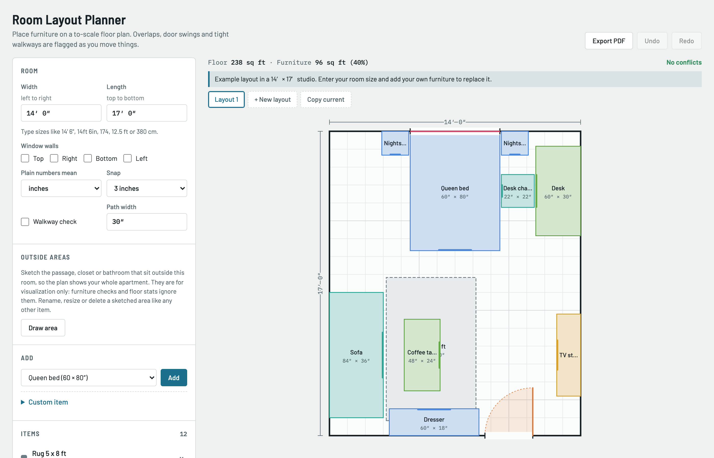

# Room Layout Planner

A free, no-build web app for planning furniture layouts on a to-scale floor plan. Place beds, sofas, desks, doors and windows in your room, drag them around, and the planner flags overlaps, blocked door swings and tight walkways as you go.



## Features

- **To-scale floor plan** — type your room size in any format (`14' 6"`, `14ft 6in`, `174`, `12.5 ft`, `380 cm`)
- **Imperial and metric** — show every size in feet & inches, inches, centimetres or metres, and pick the unit bare numbers are read in
- **Real-time conflict checks** — overlapping furniture, items outside the room, blocked door swings, and walkways narrower than your chosen path width
- **Preset furniture catalog** — beds, nightstands, dressers, sofas, tables, desks, appliances and more, or add fully custom items
- **Doors & windows** — snap to walls, flip hinges, resize to match your openings
- **Multiple saved layouts** — tabs for comparing arrangements (e.g. "Option A" vs "Option B"), with undo/redo; click the open tab to rename it
- **Share links** — one URL encodes the whole layout; send it to anyone and they see the same plan
- **Export** — download the plan as PDF, PNG or scalable SVG; the PDF always uses the light palette so it prints well
- **Outside areas** — sketch hallways, closets or bathrooms outside the room so the plan shows your whole space
- **Measurements** — item dimensions, wall-gap measurements for the selected item, and floor/furniture area stats
- **Autosave** — your layouts persist in the browser; copy/paste text export to move a layout between devices
- **Dark mode** and responsive layout for phones and tablets

No frameworks, no build step, no server. Plain HTML, CSS and JavaScript.

## Run it

Open `index.html` in any modern browser, or serve it locally:

```sh
python3 -m http.server 8000
# then visit http://localhost:8000
```

## Deploy it

It's a fully static site, so it works anywhere:

- **GitHub Pages** — Settings → Pages → deploy from the `main` branch
- **Netlify / Vercel / Cloudflare Pages** — point them at the repo root, no build command needed
- Any static file server

## Project structure

```
index.html      markup and document head
css/styles.css  all styling, including dark-mode variables
js/app.js       state, rendering, interaction and persistence
docs/           screenshots
```

## Units

Two independent controls:

| Control | Effect |
| --- | --- |
| **Show sizes in** | How every measurement is displayed: feet & inches, inches, centimetres or metres. Grid spacing, snap increments and area stats follow along. |
| **Plain numbers mean** | The unit used when a value has no suffix — inches, feet, centimetres or metres. |

Units written out are always understood, whatever the settings: `6'`, `6 ft`, `6ft 4in`, `6' 4"`, `180`, `180 cm`, `1.8 m`.

## Tips

- Drag to move; arrow keys nudge 1″ (Shift for 6″); `R` rotates 90°; `Delete` removes
- The bold tick on an item marks its front edge
- Grid lines are 1 ft apart (50 cm in metric mode)
- Doors and windows snap to the nearest wall
- **Draw area** sketches a rectangle anywhere on the plan (including outside the room) for visualization only
- **Share link** packs the current layout into the address — paste it into any chat and the recipient gets your exact plan

## License

[MIT](LICENSE) — free to use, modify and share.
